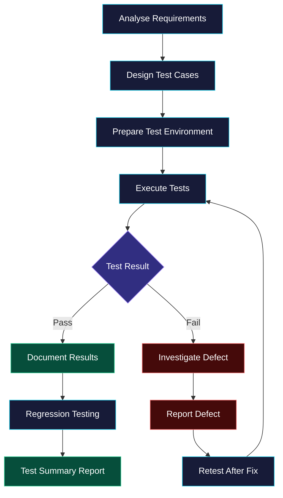
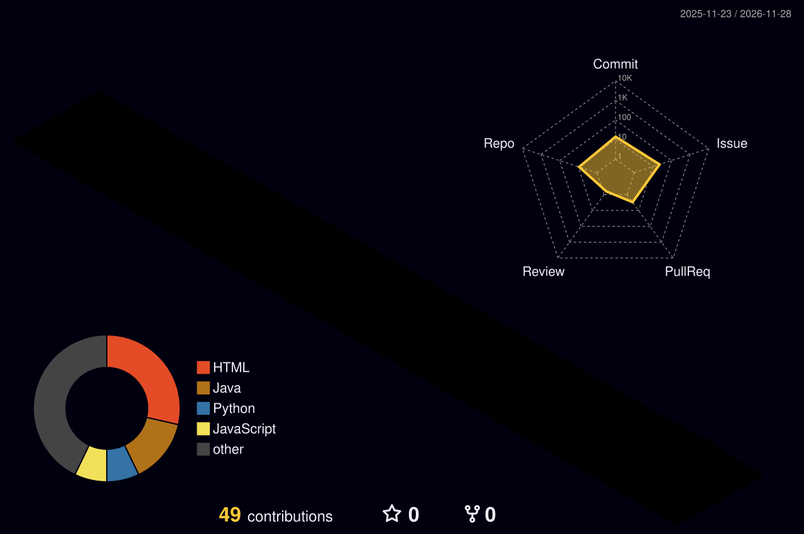

<div align="center">


<br/>


<br/>


</div>

---

## 01 // Behind the Quality

I am a final-year Software Development student at WeThinkCode_, specialising in Quality Assurance and Test Automation.

I am passionate about understanding software behaviour, identifying defects and improving software reliability.

My approach to testing combines curiosity, analytical thinking, attention to detail and continuous learning.

I am building practical experience in manual testing, automated testing and AI-assisted quality assurance through independent projects.

My goal is to become a skilled QA Automation Engineer who contributes to delivering reliable, secure and high-quality software.

---

## 02 // Quality Engineering Capabilities

<table>
<tr>
<td align="center" width="25%">


### Manual Testing

Test Planning

Test Case Design

Functional Testing

Regression Testing

</td>
<td align="center" width="25%">


### Automation

C# and NUnit

Playwright

Selenium

Unit Testing

</td>
<td align="center" width="25%">


### API Testing

REST APIs

Swagger

JSON

SQL

</td>
<td align="center" width="25%">


### Defect Analysis

Bug Identification

Defect Reporting

Retesting

Documentation

</td>
</tr>
</table>

---

## 03 // Technology Arsenal

<div align="center">

### Programming and Development


### Testing and Automation


### API and Database Technologies


### Version Control and CI/CD


</div>

---

## 04 // Independent QA Projects

<table>
<tr>
<td width="50%" valign="top">

<div align="center">


### QA TestPilot AI


</div>

An AI-powered software testing assistant designed to generate and validate structured test cases from software requirements.

**Key features**

- Software requirement analysis
- AI-assisted test case generation
- Test case validation
- Structured testing documentation
- Command-line interface

**Technology stack**

Python, AI APIs, JSON and GitHub Actions.

<div align="center">

<a href="https://github.com/lorrainemkwebo/qa-testpilot-ai">

</a>

</div>

</td>
<td width="50%" valign="top">

<div align="center">


### Sauce Demo Testing


</div>

An independent testing project focused on validating the functionality and reliability of an e-commerce application.

**Testing coverage**

- User authentication
- Product functionality
- Shopping cart operations
- Checkout processes
- Order confirmation
- Defect reporting
- Automated UI testing

**Project deliverables**

Test plan, test cases, defect reports, test execution report and automated tests.

**Technology stack**

Manual Testing and Playwright.

</td>
</tr>
</table>

---

## 05 // My Quality Engineering Process



---

## 06 // Professional Development Matrix

| Quality Engineering Skill | Development Status |
|:---|:---|
| Manual Testing |  |
| Functional Testing |  |
| Test Case Design |  |
| Defect Reporting |  |
| Test Documentation |  |
| Playwright |  |
| C# and NUnit |  |
| AI-Assisted Testing |  |
| Selenium WebDriver |  |
| Page Object Model |  |
| API Test Automation |  |
| CI/CD Integration |  |
| ISTQB Foundation |  |

---

## 07 // GitHub Analytics

<div align="center">


<br/><br/>


</div>

---

<!--
Remove these comment markers after the 3D workflow
has successfully generated the contribution graph.

## 08 // 3D Contribution Universe

<div align="center">



</div>

---
-->

## 09 // Current Mission

```text
STATUS: ACTIVE

[ACTIVE] Master C# fundamentals
[ACTIVE] Develop NUnit automation skills
[ACTIVE] Build independent QA projects
[ACTIVE] Strengthen test design and documentation
[ACTIVE] Explore AI-assisted software testing

[QUEUED] Build a Selenium automation framework
[QUEUED] Build an API testing framework
[QUEUED] Implement automated CI/CD testing
[QUEUED] Earn ISTQB Foundation certification

PRIMARY OBJECTIVE:
Become a professional QA Automation Engineer.
```

---

## 10 // Education

### WeThinkCode_

**Occupational Certificate: Software Developer**

- NQF Level 6
- Final-year student
- Specialisation: Quality Assurance
- Expected graduation: February 2027

---

## 11 // Professional Opportunities

<div align="center">

I am open to QA internships, graduate programmes and junior software testing opportunities where I can contribute, learn and grow.


<a href="https://github.com/lorrainemkwebo">

</a>

</div>

---

<div align="center">

## My Quality Philosophy

*"Quality is not just about finding bugs. It is about building confidence in the software people depend on."*

<br/>

**QUALITY IS MY CRAFT. AUTOMATION IS MY FUTURE.**

<br/>


</div>
